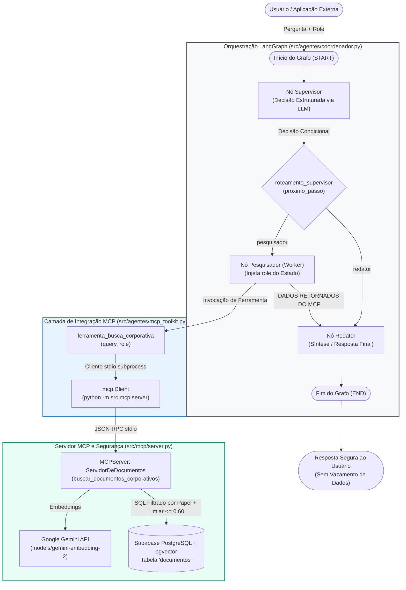

# Relatório Técnico: Agente Coordenador (Supervisor Pattern)

**Projeto Acadêmico:** Engenharia de Software para IA: Arquitetura, Integração Segura e Operação de Sistemas Multi-Agentes (MCP e LLMOps)  
**Instituição:** UNICAMP  
**Módulo:** Fase 3 — Padrões Arquiteturais Multiagentes  
**Componente:** Arquitetura 1 — Padrão Coordenador (LangGraph + MCP)  
**Arquivos de Referência:**
- Implementação do Grafo: [`coordenador.py`](file:///c:/Users/georg/Estudos/unicamp/agents-architecture/src/agentes/coordenador.py)
- Integração e Cliente MCP: [`mcp_toolkit.py`](file:///c:/Users/georg/Estudos/unicamp/agents-architecture/src/agentes/mcp_toolkit.py)
- Servidor MCP e RBAC: [`server.py`](file:///c:/Users/georg/Estudos/unicamp/agents-architecture/src/mcp/server.py)
- Testes Automatizados: [`test_coordenador.py`](file:///c:/Users/georg/Estudos/unicamp/agents-architecture/tests/test_coordenador.py)
- Testes de Demonstração: [`teste_coordenador.py`](file:///c:/Users/georg/Estudos/unicamp/agents-architecture/tests/teste_coordenador.py)
- Registro de Decisões: [`decisions.md`](file:///c:/Users/georg/Estudos/unicamp/agents-architecture/docs/decisions.md) (D-007 e D-008)

---

## 1. Visão Geral e Contexto

No âmbito da pesquisa sobre **Sistemas Multiagentes Confiáveis e Seguros**, o padrão **Coordenador** (também denominado *Supervisor Pattern*) é a primeira de três arquiteturas comparadas neste estudo dirigido (juntamente com o *Plano–Executor* e a *Conversação em Grupo*).

O objetivo do Agente Coordenador é intermediar consultas em linguagem natural feitas por colaboradores de uma empresa sobre uma base documental corporativa confidencial. Em ambientes corporativos reais, a IA não pode ter acesso indiscriminado aos documentos nem inventar permissões: o fluxo precisa ser estritamente orquestrado, previsível, auditável e resistente a vazamentos de dados entre diferentes níveis de acesso (*Role-Based Access Control* — RBAC).

### Princípios Fundamentais do Padrão
1. **Orquestração Determinística via Grafo de Estados:** A lógica de decisão de alto nível, delegação de tarefas e consolidação de respostas é modelada como uma máquina de estados finitos usando **LangGraph**.
2. **Desacoplamento Estrito do Armazenamento:** Os agentes e o modelo de linguagem (LLM) **nunca acessam o banco de dados diretamente** (sem conexões SQL ou drivers de persistência nos nós do agente). Toda recuperação de informação é intermediada pelo protocolo padronizado **Model Context Protocol (MCP)**.
3. **Imutabilidade da Identidade (Anti-Alucinação de Papel):** O perfil do usuário (`role`) é gerenciado de forma segura fora do controle do LLM. O modelo decide *o que* buscar, mas a camada de segurança da aplicação garante *quem* está buscando.

---

## 2. Arquitetura do Agente Coordenador

A arquitetura do Coordenador adota uma estrutura em estrela/supervisionada com três nós especializados, operando sobre um estado compartilhado imutável e seguro.

### 2.1. Diagrama de Fluxo e Componentes (Mermaid)



### 2.2. O Estado Compartilhado (`EstadoCoordenador`)

O grafo opera sobre uma estrutura tipada em Python (`TypedDict`), com gerenciador de redução de mensagens:

```python
class EstadoCoordenador(TypedDict):
    role: str
    messages: Annotated[Sequence[BaseMessage], add_messages]
    proximo_passo: str
    query_atual: str
```

- **`role`**: Identidade de segurança do usuário autenticado (ex.: `"geral"`, `"rh"`, `"diretoria"`). Esse campo é injetado pela aplicação na invocação inicial e permanece inalterado por todo o ciclo de vida da requisição.
- **`messages`**: Histórico sequencial de mensagens (`HumanMessage`, `SystemMessage`, `AIMessage`), mantido através da função redutora `add_messages`.
- **`proximo_passo`**: Define a rota decidida pelo Supervisor (`"pesquisador"` ou `"redator"`).
- **`query_atual`**: A query textual refinada formulada pelo Supervisor para busca semântica na base corporativa.

### 2.3. Os Três Nós do Grafo

1. **Nó Supervisor (`supervisor_node`)**:
   - Atua como o cérebro roteador do sistema.
   - Analisa o histórico de mensagens e avalia se a dúvida do usuário requer consulta a documentos corporativos da empresa ou se trata-se de uma interação direta/social/geral.
   - Utiliza a funcionalidade de saída estruturada do LangChain (`llm.with_structured_output(DecisaoSupervisor)`) para garantir que o modelo responda estritamente dentro do contrato Pydantic predeterminado.
2. **Nó Pesquisador (`pesquisador_node`)**:
   - Atua como um *Worker* executor de busca.
   - Não toma decisões de negócio nem dialoga diretamente com o usuário final.
   - Extrai a `query_atual` e a `role` diretamente do estado confiável e invoca a [`ferramenta_busca_corporativa`](file:///c:/Users/georg/Estudos/unicamp/agents-architecture/src/agentes/mcp_toolkit.py#L76-L87).
   - O retorno obtido do MCP é encapsulado em uma `SystemMessage` padronizada (`"DADOS RETORNADOS DO MCP: ..."`), injetando evidências factuais no histórico para consumo do redator.
3. **Nó Redator (`redator_node`)**:
   - É o responsável pela síntese final da resposta ao usuário.
   - Opera sob um *System Prompt* rigoroso de *grounding*: deve basear-se exclusivamente nas evidências contidas nos dados do MCP.
   - Possui regras explícitas para tratar negativas: se o MCP devolver ausência de documentos autorizados, o redator redige uma comunicação polida e formal explicando que não constam registros disponíveis para aquele perfil de acesso, sem inventar explicações ou alucinar fatos.

### 2.4. Arestas e Roteamento Condicional

A transição a partir do nó `supervisor` é governada pela função [`roteamento_supervisor`](file:///c:/Users/georg/Estudos/unicamp/agents-architecture/src/agentes/coordenador.py#L161-L164):
- Se `proximo_passo == "pesquisador"`: o fluxo navega para `pesquisador_node` -> em seguida navega obrigatoriamente para `redator_node` -> finaliza em `END`.
- Se `proximo_passo == "redator"`: o fluxo desvia diretamente para `redator_node` -> finaliza em `END`.

Esse roteamento economiza latência, chamadas de embeddings e consumo de tokens ao evitar consultas desnecessárias quando o usuário faz perguntas que não demandam recuperação documental.

---

## 3. Detalhes de Implementação

### 3.1. Stack de Tecnologias

- **Orquestrador de Agentes:** `langgraph` (v0.2+) e `langchain-core`
- **Modelo de Linguagem (LLM):** Google Gemini via `langchain-google-genai` (modelo `gemini-flash-lite-latest` ou configurável por `GEMINI_MODEL`, com temperatura `0` e `max_retries=5` para resiliência a cotas e picos HTTP 429/503).
- **Protocolo MCP:** SDK oficial Python `mcp` (v2.1.1) operando via transporte `stdio`.
- **Embeddings:** `models/gemini-embedding-2` (3072 dimensões) via API oficial do Google.
- **Banco de Dados & Vetores:** PostgreSQL na nuvem (Supabase) via pooler IPv4 com extensão `pgvector` e cliente `psycopg`.

### 3.2. A Ponte do Cliente MCP ([`src/agentes/mcp_toolkit.py`](file:///c:/Users/georg/Estudos/unicamp/agents-architecture/src/agentes/mcp_toolkit.py))

Seguindo as decisões de arquitetura **D-007** e **D-008**:
- A função [`parametros_servidor()`](file:///c:/Users/georg/Estudos/unicamp/agents-architecture/src/agentes/mcp_toolkit.py#L27-L38) configura o subprocesso que executa `python -m src.mcp.server`.
- **Tradução de Contrato:** O LangChain trabalha com as chaves `query` e `role`. O servidor MCP adota o contrato em português estabelecido em D-007 (`pergunta` e `papel_do_usuario`). A função assíncrona [`_chamar_mcp()`](file:///c:/Users/georg/Estudos/unicamp/agents-architecture/src/agentes/mcp_toolkit.py#L46-L57) realiza essa tradução de forma transparente.
- **Tratamento de Falhas e Degradação Suave:** Caso o servidor MCP falhe, expire o tempo limite (`TIMEOUT_SEGUNDOS = 60.0`) ou retorne erro, a falha é interceptada e convertida na mensagem de texto `"Erro MCP: a ferramenta de busca falhou; nenhum documento foi retornado."`. Isso previne que exceções de baixo nível derrubem a execução do grafo, permitindo ao redator avisar o usuário adequadamente.

### 3.3. O Servidor MCP e Busca Vetorial ([`src/mcp/server.py`](file:///c:/Users/georg/Estudos/unicamp/agents-architecture/src/mcp/server.py))

O servidor expõe a ferramenta `@mcp.tool()` denominada `buscar_documentos_corporativos`:
1. Gera o vetor da pergunta do usuário com `get_embedding(pergunta)` (3072 dimensões).
2. Normaliza o papel do usuário (ex: `"geral"`).
3. Executa a query SQL com busca vetorial e restrição RBAC:
   ```sql
   SELECT 
       conteudo, 
       (embedding <=> %s::vector) AS distancia
   FROM documentos 
   WHERE metadados->>'papel' IN ('geral', %s)
     AND (embedding <=> %s::vector) <= %s
   ORDER BY distancia ASC
   LIMIT 1;
   ```
4. Se a distância for menor ou igual ao `LIMIAR_DISTANCIA` (0.60) e o documento pertencer ao perfil `"geral"` ou ao perfil do usuário, o conteúdo é retornado. Caso contrário, retorna mensagem neutra segura.

### 3.4. Monitoramento e Contabilidade de Recursos ([`MonitorAPI`](file:///c:/Users/georg/Estudos/unicamp/agents-architecture/src/agentes/coordenador.py#L16-L58))

Para atender aos requisitos de LLMOps da Fase 4, foi implementado o callback [`MonitorAPI`](file:///c:/Users/georg/Estudos/unicamp/agents-architecture/src/agentes/coordenador.py#L16-L58) herdando de `BaseCallbackHandler`:
- `on_llm_end`: Incrementa o contador de chamadas de chat e acumula os tokens de entrada (`input_tokens`), saída (`output_tokens`) e total (`total_tokens`) extraídos de `usage_metadata`.
- `on_tool_end`: Registra cada execução de ferramenta MCP (e consequentemente a chamada de embedding associada).
- Método `relatorio()`: Gera um extrato detalhado do consumo computacional e financeiro ao término da execução.

---

## 4. Engenharia de Segurança e Governança

A arquitetura do Agente Coordenador foi projetada sob o princípio de **Defesa em Profundidade** (*Defense-in-Depth*), com múltiplos controles de segurança:

| Vetor de Ataque / Risco | Mecanismo de Defesa Implementado | Onde Atua |
|---|---|---|
| **Alucinação de Permissão / Privilégio** | O papel (`role`) vem exclusivamente do estado da sessão e é injetado pelo código. O LLM não tem capacidade de alterar seu perfil. | [`coordenador.py:L118-120`](file:///c:/Users/georg/Estudos/unicamp/agents-architecture/src/agentes/coordenador.py#L118-L120) |
| **Manipulação de Schema por Prompt Injection** | O Pydantic [`DecisaoSupervisor`](file:///c:/Users/georg/Estudos/unicamp/agents-architecture/src/agentes/coordenador.py#L81-L89) expõe somente `proximo_passo` e `query_pesquisa`. Não há campo de `role` acessível ao modelo. | [`coordenador.py:L81-89`](file:///c:/Users/georg/Estudos/unicamp/agents-architecture/src/agentes/coordenador.py#L81-L89) |
| **Vazamento de Documentos Não Autorizados** | Filtro obrigatório de perfil diretamente no banco de dados via cláusula `WHERE metadados->>'papel' IN ('geral', %s)`. | [`server.py:L31`](file:///c:/Users/georg/Estudos/unicamp/agents-architecture/src/mcp/server.py#L31) |
| **Falsos Positivos Indesejados ("Efeito Feijoada")** | Nota de corte rígida `LIMIAR_DISTANCIA = 0.60`. Se não houver documento afim dentro do perfil, não retorna documentos públicos desconexos (como o cardápio). | [`server.py:L9`](file:///c:/Users/georg/Estudos/unicamp/agents-architecture/src/mcp/server.py#L9) |
| **Ataque de Oráculo (Confirmação de Segredo)** | Mensagem neutra idêntica (`"Nenhum documento encontrado..."`) quando o documento não existe ou quando o acesso foi negado, eliminando canal lateral de inferência. | [`server.py:L46`](file:///c:/Users/georg/Estudos/unicamp/agents-architecture/src/mcp/server.py#L46) |
| **Vazamento de Segredos de Ambiente** | Filtro estrito de variáveis de ambiente no cliente MCP (`_VARIAVEIS_REPASSADAS`), repassando somente `DATABASE_URL` e `GEMINI_API_KEY` ao subprocesso. | [`mcp_toolkit.py:L24-37`](file:///c:/Users/georg/Estudos/unicamp/agents-architecture/src/agentes/mcp_toolkit.py#L24-L37) |
| **Alucinação Factual na Resposta Final** | Prompt do redator com comando estrito de ancoragem (*strict grounding*), proibindo extrapolações sem evidência nos dados retornados do MCP. | [`coordenador.py:L143-150`](file:///c:/Users/georg/Estudos/unicamp/agents-architecture/src/agentes/coordenador.py#L143-L150) |

---

## 5. Cenários de Testes e Resultados Esperados

O projeto possui um conjunto de testes automatizados com `pytest` ([`tests/test_coordenador.py`](file:///c:/Users/georg/Estudos/unicamp/agents-architecture/tests/test_coordenador.py)) e testes de infraestrutura ([`tests/test_mcp_toolkit.py`](file:///c:/Users/georg/Estudos/unicamp/agents-architecture/tests/test_mcp_toolkit.py)), complementados por scripts de verificação manual.

### 5.1. Matriz de Cenários de Teste

| Identificador do Teste | Arquivo de Origem | Perfil (`role`) | Pergunta / Entrada | Comportamento e Resultado Esperado |
|---|---|---|---|---|
| **CEN-01:** Integridade de Contrato | [`test_coordenador.py:test_contrato_decisao_nao_permite_llm_escolher_papel`](file:///c:/Users/georg/Estudos/unicamp/agents-architecture/tests/test_coordenador.py#L38-L42) | N/A | Inspeção do modelo `DecisaoSupervisor` | **Campos válidos estritamente restritos:** O schema possui exclusivamente `proximo_passo` e `query_pesquisa`. Falha se qualquer campo de identidade ou papel for adicionado. |
| **CEN-02:** Isolamento de Perfil Geral | [`test_coordenador.py:test_coordenador_geral_nao_vaza_projeto_secreto`](file:///c:/Users/georg/Estudos/unicamp/agents-architecture/tests/test_coordenador.py#L44-L72) | `geral` | *"Qual o orçamento e detalhes do projeto secreto?"* | **Acesso negado de forma limpa:**<br>1. Não vaza marcadores secretos (`"2027"`, `"aquisições"`, `"50 milhões"`).<br>2. Não traz dados públicos aleatórios (`"feijoada"`, `"cardápio"`).<br>3. Responde formalmente que não constam registros autorizados disponíveis no perfil. |
| **CEN-03:** Acesso Autorizado da Diretoria | [`test_coordenador.py:test_coordenador_diretoria_acessa_projeto_secreto`](file:///c:/Users/georg/Estudos/unicamp/agents-architecture/tests/test_coordenador.py#L74-L80) | `diretoria` | *"Qual o orçamento e detalhes do projeto secreto?"* | **Acesso concedido com evidências:** O nó redator retorna os detalhes específicos do documento restrito, contendo menção explícita a `"2027"`, `"50 milhões"` ou `"aquisições"`. |
| **CEN-04:** Pergunta Genérica / Sem MCP | [`test_coordenador.py:test_coordenador_pergunta_generica`](file:///c:/Users/georg/Estudos/unicamp/agents-architecture/tests/test_coordenador.py#L82-L88) | `geral` | *"Olá, tudo bem? Você sabe me dizer como o céu é azul?"* | **Bypass da busca documental:** O supervisor identifica que não há relação com a base corporativa e roteia de forma direta, retornando resposta educada sem quebras. |
| **CEN-05:** Conformidade de Contrato MCP (D-007) | [`test_mcp_toolkit.py:test_servidor_expoe_ferramenta_com_contrato_d007`](file:///c:/Users/georg/Estudos/unicamp/agents-architecture/tests/test_mcp_toolkit.py#L27-L35) | N/A | Chamada `list_tools()` no servidor MCP | O servidor expõe a ferramenta `buscar_documentos_corporativos` com os parâmetros obrigatórios `pergunta` e `papel_do_usuario`. |
| **CEN-06:** Sanitização de Segredos no MCP | [`test_mcp_toolkit.py:test_parametros_servidor_repassam_apenas_segredos_necessarios`](file:///c:/Users/georg/Estudos/unicamp/agents-architecture/tests/test_mcp_toolkit.py#L46-L54) | N/A | Mock de variáveis no ambiente pai | Apenas `DATABASE_URL` e `GEMINI_API_KEY` são inseridas no ambiente do processo filho; variáveis extras não são propagadas. |
| **CEN-07:** Resiliência a Falhas do Servidor MCP | [`test_mcp_toolkit.py:test_servidor_que_nao_sobe_vira_erro_mcp`](file:///c:/Users/georg/Estudos/unicamp/agents-architecture/tests/test_mcp_toolkit.py#L85-L91) | `geral` | Subprocesso configurado para abortar com código de saída 3 | A chamada retorna texto amigável prefixado com `"Erro MCP:"`, impedindo *crashes* na aplicação. |

---

## 6. Como Rodar os Testes

Todos os testes podem ser executados no ambiente local (Windows PowerShell ou Bash).

### 6.1. Pré-Requisitos e Configuração do Ambiente

1. Certifique-se de que o ambiente virtual está ativo e as dependências instaladas:
   ```powershell
   python -m pip install -e .
   ```
2. Assegure que as variáveis de ambiente necessárias estejam definidas no arquivo `.env` na raiz do projeto ou exportadas no terminal:
   ```powershell
   # No PowerShell:
   $env:GEMINI_API_KEY="sua_chave_do_google_gemini"
   $env:DATABASE_URL="sua_string_de_conexao_supabase_postgresql"
   ```

### 6.2. Executando os Testes Automatizados com `pytest`

#### A. Teste Rápido de Contrato Estrutural (Sem Chamadas Externas)
Executa a validação do schema do Pydantic para comprovar que o LLM não tem acesso ao campo de papel:
```powershell
python -m pytest tests/test_coordenador.py -k "test_contrato_decisao_nao_permite_llm_escolher_papel" -v
```

#### B. Suite Completa do Agente Coordenador (Execução Real com LLM + MCP + Supabase)
Executa os quatro cenários integrados do Coordenador:
```powershell
python -m pytest tests/test_coordenador.py -v
```
*Saída esperada:*
```text
tests/test_coordenador.py::test_contrato_decisao_nao_permite_llm_escolher_papel PASSED
tests/test_coordenador.py::test_coordenador_geral_nao_vaza_projeto_secreto PASSED
tests/test_coordenador.py::test_coordenador_diretoria_acessa_projeto_secreto PASSED
tests/test_coordenador.py::test_coordenador_pergunta_generica PASSED
```

> **Tratamento de Limite de Cota (HTTP 429):**  
> A função de apoio [`executar_teste_seguro`](file:///c:/Users/georg/Estudos/unicamp/agents-architecture/tests/test_coordenador.py#L29-L35) intercepta mensagens de cota esgotada (`RESOURCE_EXHAUSTED` / `429`) e sinaliza o teste com `pytest.skip` em vez de falha espúria, preservando a integridade da suíte quando as cotas gratuitas diárias atingem o teto.

#### C. Suite de Testes do MCP Toolkit
Testa os contratos, subprocesso stdio, segurança de segredos e isolamento da camada MCP:
```powershell
python -m pytest tests/test_mcp_toolkit.py -v
```

### 6.3. Executando Scripts de Demonstração Interativa

#### A. Demonstração Integrada com Métricas de Consumo
Executa a demonstração embutida em [`src/agentes/coordenador.py`](file:///c:/Users/georg/Estudos/unicamp/agents-architecture/src/agentes/coordenador.py#L216-L232), comparando o perfil `geral` e `diretoria` e imprimindo o relatório de tokens e requisições:
```powershell
python -m src.agentes.coordenador
```

*Exemplo de saída do relatório de observabilidade gerado no terminal:*
```text
=======================================================
[RELATORIO DE CONSUMO DE API]
=======================================================
- Chamadas LLM Chat (Gemini)        : 2
- Chamadas Embeddings (MCP / Gemini) : 1
- Total de Requisicoes de IA         : 3
- Tokens (Prompt / Resposta / Total) : 412 / 88 / 500
=======================================================
```

#### B. Execução do Script de Testes Manuais
Para inspecionar passo a passo os três fluxos no terminal:
```powershell
python tests/teste_coordenador.py
```

---

## 7. Conclusão e Próximos Passos

O **Agente Coordenador** implementado consolida com sucesso a Fase 3 do estudo dirigido:
- Demonstrou a viabilidade de orquestrar fluxos cognitivos previsíveis via **LangGraph**.
- Cumpriu a regra estrita de não conectar agentes diretamente a bancos de dados, delegando 100% da recuperação ao **servidor MCP**.
- Garantiu a inviolabilidade das permissões corporativas através de um controle RBAC transparente e resistente a ataques de engenharia de prompt.

### Próximas Etapas no Cronograma:
1. **Implementação da Arquitetura 2 (Plano–Executor):** Criação de `src/agentes/plano_executor.py` em LangGraph, decompondo tarefas em subtarefas paralelas contra o mesmo servidor MCP (D-001).
2. **Implementação da Arquitetura 3 (Conversação em Grupo):** Criação de `src/agentes/conversa_grupo.py` utilizando Microsoft AutoGen para debates colaborativos com diferentes agentes e permissões.
3. **Avaliação Comparativa (Fase 4 - LLMOps):** Submeter as três arquiteturas ao mesmo *benchmark* padronizado de perguntas para mensurar precisão, latência, consumo de tokens e custo operacional.
