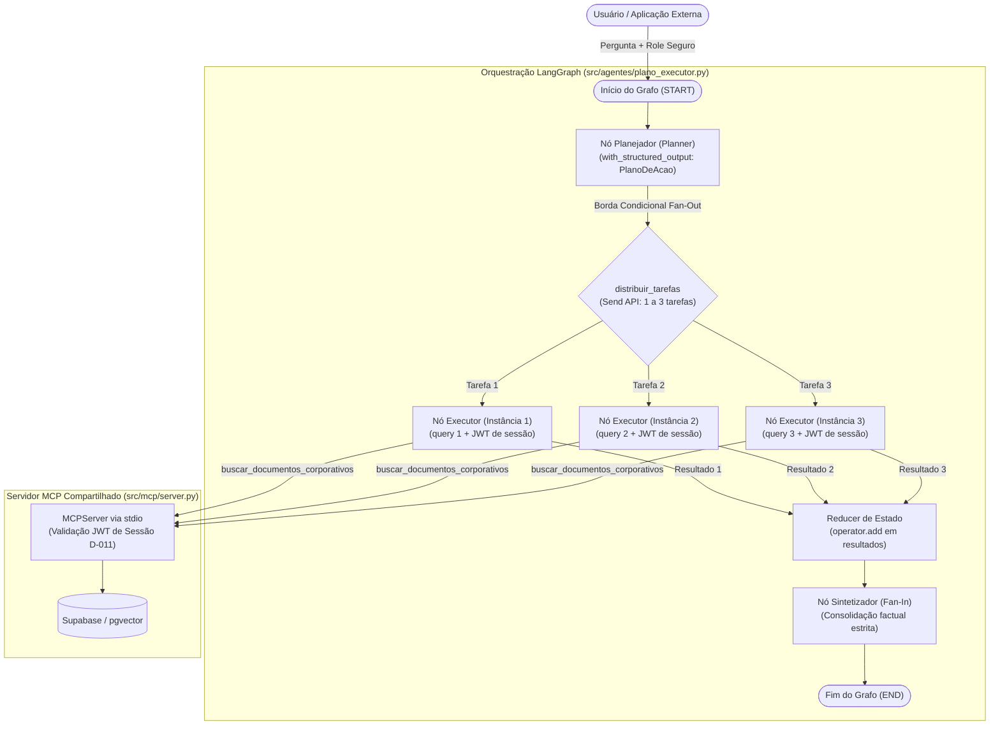

# Relatório Técnico: Agente Plano–Executor (Plan-and-Execute Pattern)

**Projeto Acadêmico:** Engenharia de Software para IA: Arquitetura, Integração Segura e Operação de Sistemas Multi-Agentes (MCP e LLMOps)  
**Instituição:** UNICAMP  
**Módulo:** Fase 3 — Padrões Arquiteturais Multiagentes  
**Componente:** Arquitetura 2 — Padrão Plano–Executor (LangGraph + MCP)  
**Arquivos de Referência:**
- Implementação do Grafo: [`src/agentes/plano_executor.py`](file:///c:/Users/georg/Estudos/unicamp/agents-architecture/src/agentes/plano_executor.py)
- Integração e Cliente MCP: [`src/agentes/mcp_toolkit.py`](file:///c:/Users/georg/Estudos/unicamp/agents-architecture/src/agentes/mcp_toolkit.py)
- Servidor MCP e RBAC: [`src/mcp/server.py`](file:///c:/Users/georg/Estudos/unicamp/agents-architecture/src/mcp/server.py)
- Testes Automatizados: [`tests/test_plano_executor.py`](file:///c:/Users/georg/Estudos/unicamp/agents-architecture/tests/test_plano_executor.py)
- Testes de Demonstração: [`tests/teste_plano_executor.py`](file:///c:/Users/georg/Estudos/unicamp/agents-architecture/tests/teste_plano_executor.py)
- Registro de Decisões: [`docs/decisions.md`](file:///c:/Users/georg/Estudos/unicamp/agents-architecture/docs/decisions.md) (D-001, D-010, D-011 e D-012)
- Diagrama Conceitual da Fase 1: [`docs/diagramas/plano-executor.mmd`](file:///c:/Users/georg/Estudos/unicamp/agents-architecture/docs/diagramas/plano-executor.mmd)

---

## 1. Visão Geral e Motivação

O padrão **Plano–Executor (Plan-and-Execute)** é a segunda arquitetura multiagente implementada e avaliada neste estudo dirigido. Em contraste com o padrão *Coordenador* (que delega a busca a um único pesquisador de forma reativa), o *Plano–Executor* separa explicitamente a fase de raciocínio estratégico e decomposição de problemas da fase de coleta factual e execução.

### Diferenças Fundamentais em Relação ao Coordenador

| Dimensão | Padrão Coordenador (Supervisor) | Padrão Plano–Executor |
|---|---|---|
| **Estratégia de Busca** | Reativa: o supervisor decide se busca ou responde direto em uma única consulta | Proativa: o planejador decompõe a pergunta em subtarefas estruturadas |
| **Paralelismo** | Linear / Monotarefa (1 busca por vez) | Concorrente: tarefas executam em paralelo via Fan-Out (D-001, D-012) |
| **Escopo de Tarefas** | Única query formulada pelo supervisor | 1 a 3 tarefas complementares cobrindo diferentes aspectos (ex.: orçamento, datas, escopo) |
| **Ponto de Consolidação** | Redator recebe a resposta única do pesquisador | Sintetizador recebe o conjunto de evidências consolidadas (Fan-In) |

---

## 2. Arquitetura do Grafo LangGraph

A arquitetura do Plano–Executor implementa o padrão clássico **Map-Reduce / Fan-Out / Fan-In** sobre o LangGraph.

### 2.1. Diagrama de Fluxo e Componentes (Mermaid)



### 2.2. Contratos de Dados e Estado

O estado é tipado e utiliza redutor para acomodar a escrita paralela das instâncias do executor:

```python
class Subtarefa(BaseModel):
    id: int
    descricao: str
    query_busca: str

class PlanoDeAcao(BaseModel):
    tarefas: list[Subtarefa] = Field(min_length=1, max_length=3)

class EstadoPlanoExecutor(TypedDict):
    role: str                                                  # Role imutável da sessão
    pergunta: str                                              # Pergunta original
    plano: list[dict]                                          # Lista serializada de tarefas
    resultados: Annotated[list[dict], operator.add]            # Reducer para Fan-In concorrente
    resposta_final: str                                        # Síntese final redigida
```

---

## 3. Segurança e Isolamento RBAC

O Plano–Executor preserva estritamente todas as barreiras de segurança definidas nas decisões anteriores:

1. **Schema sem Parâmetro de Papel (D-010):** A estrutura `PlanoDeAcao` e `Subtarefa` contém apenas `id`, `descricao` e `query_busca`. O LLM é tecnicamente impedido de selecionar ou forjar perfis de usuário (`role`/`papel`).
2. **Propagação Segura pelo Grafo:** A borda condicional `distribuir_tarefas` extrai o `role` diretamente do estado autenticado da sessão e o injeta no payload da `Send API`.
3. **Autenticação Criptográfica na Sessão MCP (D-011):** Cada executor, ao invocar `criar_ferramenta_busca(role)`, aciona o subprocesso `python -m src.mcp.server` com token JWT assinado (`HS256`) contendo a claim do papel. O servidor MCP valida a assinatura e aplica os filtros de visibilidade na query SQL com `pgvector`.
4. **Falha Fechada e Anti-Alucinação:** Se o usuário pertencer ao perfil `geral` e solicitar dados sigilosos (como o *Projeto Secreto*), os executores recebem mensagens de ausência de registros autorizados. O nó sintetizador é instruído a responder com recusa formal e neutra, sem alucinar valores nem vazar dados alheios.

---

## 4. Otimização Concorrente: Fan-Out Dinâmico (1 a 3 Tarefas)

Conforme formalizado na decisão **D-012**:
- O plano original da Fase 1 sugeria estaticamente 3 tarefas. No entanto, para consultas simples (ex.: *"Qual o cardápio do almoço?"*), forçar 3 tarefas gerava buscas redundantes e desperdício de tokens.
- O nó Planejador opera de modo **dinâmico limitado (1 a 3 tarefas)**:
  - Perguntas pontuais: geram 1 subtarefa direcionada.
  - Perguntas amplas ou multidimensionais: geram 2 ou 3 subtarefas independentes executadas em paralelo.
- A orquestração via **`Send` API** do LangGraph garante que o mesmo nó executor seja instanciado concorrentemente pelo framework, eliminando código duplicado de nós estáticos.

---

## 5. Resultados e Evidências dos Testes Automatizados

A suíte de testes em [`tests/test_plano_executor.py`](file:///c:/Users/georg/Estudos/unicamp/agents-architecture/tests/test_plano_executor.py) foi executada de ponta a ponta contra a infraestrutura real (Google Gemini Flash + Servidor MCP stdio + Supabase com pgvector):

```powershell
python -m pytest tests/test_plano_executor.py -v
```

### Quadro de Verificação

| Teste | Objetivo | Resultado |
|---|---|:---:|
| `test_contrato_plano_nao_permite_llm_escolher_papel` | Valida que o schema Pydantic não aceita injeção de papel | ✅ PASSED |
| `test_contrato_limites_de_tarefas` | Garante restrição estrita de 1 a 3 tarefas no plano | ✅ PASSED |
| `test_distribuir_tarefas_injeta_role_seguro_no_send` | Garante injeção do papel seguro do estado no `Send` | ✅ PASSED |
| `test_plano_executor_geral_nao_vaza_projeto_secreto` | Perfil `geral` recebe resposta neutra sem vazamento de sigilos | ✅ PASSED |
| `test_plano_executor_diretoria_acessa_projeto_secreto` | Perfil `diretoria` recebe detalhes do orçamento e prazos | ✅ PASSED |
| `test_plano_executor_pergunta_simples_acessa_documento_geral` | Consulta pontual com 1 tarefa localiza documento público (feijoada) | ✅ PASSED |

**Resultado consolidado:** 6 testes aprovados em 30.17 segundos.

---

## 6. Como Executar

### Demonstração Interativa
```powershell
python tests/teste_plano_executor.py
```

### Execução via Linha de Comando Direta
```powershell
python -m src.agentes.plano_executor
```

### Execução da Suíte de Testes
```powershell
python -m pytest tests/test_plano_executor.py -v
```
