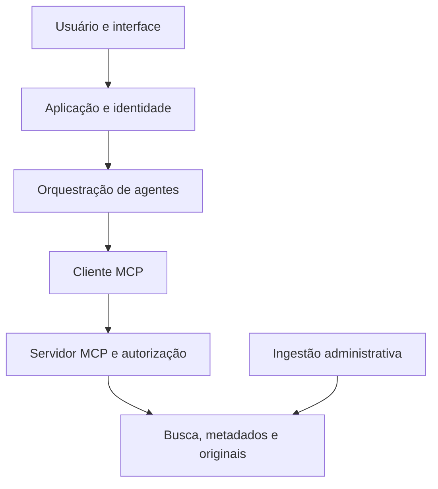

# Arquitetura geral — proposta de referência

## Fronteiras

Este diagrama é uma **abstração a conciliar com os desenhos da Fase 1**; não pretende substituir as decisões visuais existentes. A identidade da pessoa solicitante deve ser verificada pelo aplicativo e propagada de maneira confiável até a verificação de permissões no servidor. A ingestão é um fluxo administrativo separado das consultas dos agentes.

## Arquitetura Híbrida Adotada (Fase 2 em diante)

Devido às políticas rigorosas de bloqueio de execução de bibliotecas locais (AppLocker/Windows Defender), a arquitetura lógica inicial precisou migrar para um ambiente híbrido com processamento em nuvem, mantendo o controle MCP local:

1. **Persistência Unificada (Supabase/PostgreSQL):** Dados originais em texto plano, metadados de controle de acesso (`metadados->>'papel'`) e o índice vetorial (`vector(3072)`) coexistem na mesma tabela remota, garantindo RAG e segurança ACID na mesma query.
2. **Embeddings em Nuvem (Google Gemini):** A transformação de textos cruciais em representação semântica é terceirizada via API (`models/gemini-embedding-2`), proporcionando escalabilidade e alta fluência em português sem as restrições de bibliotecas pesadas locais.
3. **Protocolo MCP (Stdio):** O servidor (que expõe a busca) e os futuros orquestradores Multi-Agentes comunicam-se nativamente pelo fluxo de entrada e saída (`stdio`), garantindo uma esteira local padronizada, rápida e isenta da complexidade e tokens HTTP.

## Responsabilidade de cada peça

| Componente | Responsabilidade | Não confundir com |
|---|---|---|
| Originais / object storage | Guardar o arquivo fonte, versão e integridade | Índice pesquisável ou política de acesso |
| Banco de metadados | ID estável, título, versão, classificação, permissões, localização, estado da ingestão | Texto integral como única cópia |
| Índice vetorial | Associar trechos e embeddings a IDs e versões para busca de candidatos | Fonte de verdade para permissão |
| Serviço de busca | Aplicar filtros de autorização e construir evidências com citações | Decidir sozinho quem é o usuário |
| Servidor MCP | Expor capacidades delimitadas, validar entrada, aplicar autorização e auditar | Orquestrar a estratégia de todos os agentes |
| Orquestração | Interpretar pergunta, escolher passos e compor resposta | Ler bancos diretamente |

Uma implantação simples pode colocar metadados e índice vetorial no mesmo banco, desde que as responsabilidades lógicas permaneçam separadas. Essa é uma opção em aberto, não requisito de três serviços distintos.

## Ingestão proposta

1. Receber documento autorizado para ingestão, registrar origem, proprietário, versão, classificação e checksum.
2. Preservar o original; extrair texto e registrar erros de extração.
3. Dividir em trechos com referência recuperável (arquivo, versão, página/seção e posição, quando disponíveis).
4. Gerar embeddings em lote e indexar os trechos com `document_id`, `version_id` e política de visibilidade.
5. Publicar a versão somente quando armazenamento, metadados e índice estiverem coerentes; reprovar ou reverter ingestão incompleta.
6. Ao atualizar ou revogar um documento, invalidar o índice anterior e impedir sua recuperação.

## Consulta proposta

O agente consulta uma ferramenta MCP; o servidor verifica credencial e contexto de acesso, limita a busca a documentos permitidos e devolve trechos e referências com IDs estáveis. A resposta deve associar afirmações às evidências e admitir ausência de base suficiente. Uma pontuação de similaridade sozinha não comprova correção factual.

## Contrato de evidências

Cada trecho retornado deve permitir reconstruir sua origem: `document_id`, `version_id`, `chunk_id`, `title`, `location` (página/seção quando conhecida), `excerpt` e identificador de citação. Evite expor caminhos internos ou conteúdo integral quando um trecho basta.
