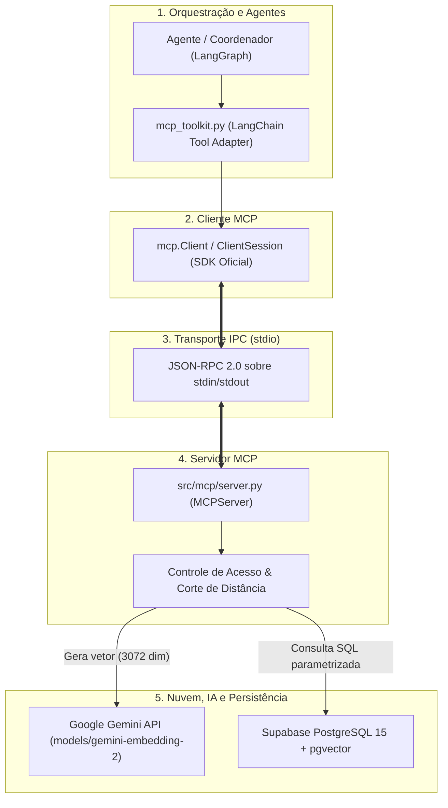
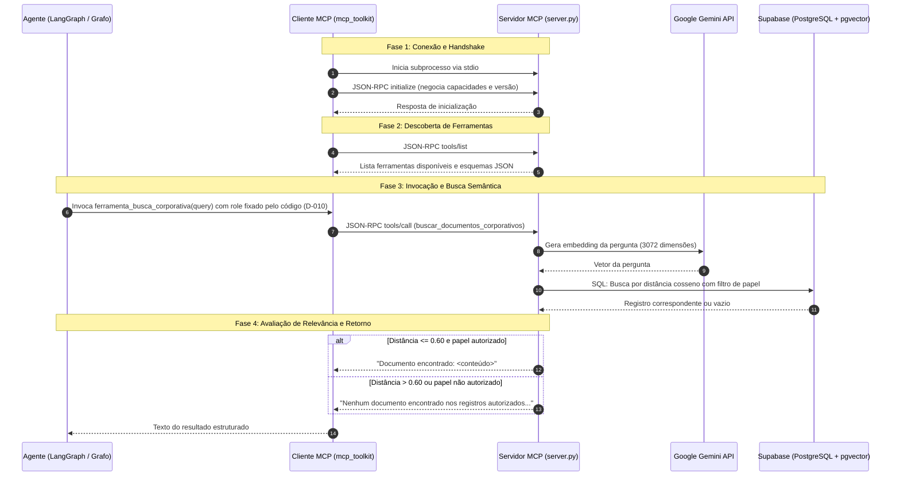

# Integração MCP: Arquitetura e Funcionamento

Este documento descreve a arquitetura, o modelo de comunicação e o funcionamento operacional do **Model Context Protocol (MCP)** no sistema de perguntas e respostas sobre documentos corporativos.

---

## 1. Visão Geral e Princípios Arquiteturais

No escopo do projeto, o MCP atua como a **fronteira estrita de segurança e isolamento de dados** entre o raciocínio dos agentes e a base documental:

1. **Desacoplamento Obrigatório:** Agentes cognitivos (LangGraph / AutoGen) **nunca acessam diretamente o banco de dados** nem executam queries SQL. Todo acesso a documentos corporativos é obrigatoriamente intermediado por um cliente MCP chamando ferramentas do servidor MCP.
2. **Autorização na Fonte (RBAC):** A filtragem de permissões por papel (*Role-Based Access Control*) ocorre na camada do servidor e no motor de busca relacional (SQL), impedindo que dados não autorizados cheguem ao contexto do modelo.
3. **Isolamento de Processos via Subprocesso:** O servidor MCP opera de forma isolada, comunicando-se com a aplicação via fluxo padrão de entrada e saída (`stdio`), sem abrir portas de rede desnecessárias e recebendo apenas as variáveis de ambiente estritamente necessárias.

---

## 2. Arquitetura de Componentes

A arquitetura do MCP neste projeto é composta por 5 camadas interligadas:



### Detalhamento dos Componentes

- **Cliente MCP ([src/agentes/mcp_toolkit.py](file:///c:/Users/georg/Estudos/unicamp/agents-architecture/src/agentes/mcp_toolkit.py) e [scripts/cliente.py](file:///c:/Users/georg/Estudos/unicamp/agents-architecture/scripts/cliente.py)):**
  - Utiliza o SDK oficial Python (`mcp`).
  - Gerencia o ciclo de vida do servidor (spawn do subprocesso `python -m src.mcp.server`).
  - Traduz os parâmetros dos frameworks de agentes (ex: `query`/`role` do LangChain) para o contrato canônico do servidor (`pergunta`/`papel_do_usuario`).
  - Sanitiza erros de transporte ou falhas de ferramenta, devolvendo mensagens amigáveis ao agente e enviando detalhes técnicos ao `stderr`.
- **Camada de Transporte (`stdio`):**
  - Adotada na decisão [D-007](file:///c:/Users/georg/Estudos/unicamp/agents-architecture/docs/decisions.md#d-007--simplificação-e-mudança-do-mcp-para-o-protocolo-stdio-2026-10-05).
  - Troca mensagens JSON-RPC 2.0 serializadas por linha de texto através de `stdin` e `stdout`.
  - Isola variáveis de ambiente: repassa unicamente `DATABASE_URL` e `GEMINI_API_KEY` ao processo filho, evitando vazamento acidental de outros segredos da aplicação.
- **Servidor MCP ([src/mcp/server.py](file:///c:/Users/georg/Estudos/unicamp/agents-architecture/src/mcp/server.py)):**
  - Instancia `MCPServer("ServidorDeDocumentos")`.
  - Registra a ferramenta `@mcp.tool() def buscar_documentos_corporativos(...)`.
  - Executa a busca semântica autorizada via função `buscar_no_banco`.
- **Serviço de Embeddings Semânticos ([src/busca/embeddings.py](file:///c:/Users/georg/Estudos/unicamp/agents-architecture/src/busca/embeddings.py)):**
  - Conforme decisão [D-006](file:///c:/Users/georg/Estudos/unicamp/agents-architecture/docs/decisions.md#d-006--adoção-da-api-do-google-gemini-para-embeddings-2026-10-05), converte a pergunta do usuário em um vetor denso de 3072 dimensões via API do Google Gemini (`models/gemini-embedding-2`).
- **Banco de Dados Relacional e Vetorial ([src/persistencia/](file:///c:/Users/georg/Estudos/unicamp/agents-architecture/src/persistencia)):**
  - Conforme decisões [D-004](file:///c:/Users/georg/Estudos/unicamp/agents-architecture/docs/decisions.md#d-004--arquitetura-de-persistência-unificada-no-postgresql-2026-09-30) e [D-005](file:///c:/Users/georg/Estudos/unicamp/agents-architecture/docs/decisions.md#d-005--migração-de-persistência-local-para-nuvem-supabase-2026-10-05), unifica metadados de controle de acesso (`JSONB`), texto puro (`conteudo`) e índice vetorial (`vector(3072)`) na tabela `documentos` do Supabase PostgreSQL.

---

## 3. Funcionamento Operacional e Ciclo de Vida

O ciclo de interação entre o agente e o servidor MCP segue 5 fases sequenciais:



### Passo a Passo das Fases

### 1. Inicialização e Handshake
O cliente instancia o transporte `stdio_client` com os parâmetros configurados em `parametros_servidor()`. É enviado o método `initialize`, negociando as versões compatíveis do protocolo MCP (ex.: versão `2026-07-28` suportada pelo SDK `mcp`).

### 2. Descoberta de Capacidades (`tools/list`)
O cliente consulta as ferramentas disponíveis no servidor sem precisar de credenciais de banco. O servidor expõe dinamicamente os metadados gerados a partir do decorador `@mcp.tool()`:
- Nome da ferramenta: `buscar_documentos_corporativos`
- Descrição da capacidade
- Esquema JSON dos parâmetros esperados (`pergunta` e `papel_do_usuario`).

### 3. Chamada da Ferramenta (`tools/call`)
Quando o agente decide buscar informações corporativas:
1. O cliente envia a requisição JSON-RPC `tools/call`.
2. O servidor extrai os argumentos validados contra o schema.

### 4. Execução Interna e Filtragem Segura
Dentro de `buscar_no_banco`:
1. **Geração do Embedding:** O texto de `pergunta` é convertido em vetor semântico pela função `get_embedding`.
2. **Execução da Query SQL Segura:** A busca combina autorização e distância vetorial em uma única instrução SQL parametrizada:
   ```sql
   SELECT 
       conteudo, 
       (embedding <=> %s::vector) AS distancia
   FROM documentos 
   WHERE metadados->>'papel' IN ('geral', %s)
     AND (embedding <=> %s::vector) <= %s
   ORDER BY distancia ASC
   LIMIT 1;
   ```
3. **Corte de Distância Semântica (`LIMIAR_DISTANCIA = 0.60`):**
   - O operador `<=>` calcula a distância cosseno (onde `0.0` é idêntico e `1.0` é ortogonal).
   - Apenas registros com distância $\le 0.60$ são considerados relevantes.
   - Perguntas irrelevantes ou fora de escopo são barradas diretamente no banco, impedindo recuperação de trechos espúrios.

### 5. Resposta Neutra e Proteção contra Ataques de Oráculo
Se o usuário não possuir permissão para o documento, ou se a pergunta não atingir o limiar de relevância, o servidor retorna exatamente a mesma mensagem neutra:
> *"Nenhum documento encontrado nos registros autorizados para o seu perfil."*

Essa uniformidade impede **ataques de inferência por oráculo**: um usuário não autorizado não consegue deduzir se um documento sigiloso existe ou não na base corporativa.

---

## 4. Contrato da Ferramenta

### Especificação da Ferramenta

| Propriedade | Valor |
|---|---|
| **Nome** | `buscar_documentos_corporativos` |
| **Descrição** | Busca documentos na base de conhecimento da empresa usando Inteligência Artificial. A identidade e as permissões de acesso são validadas de forma confiável via token JWT da sessão MCP. |
| **Transporte** | `stdio` (Standard Input / Standard Output) |
| **Protocolo** | Model Context Protocol (MCP) |
| **Autenticação** | Token JWT assinado (HS256) injetado na sessão (`MCP_AUTH_TOKEN`) |

### Esquema JSON de Entrada (`input_schema`)

```json
{
  "type": "object",
  "properties": {
    "pergunta": {
      "type": "string",
      "description": "Texto da consulta a ser buscada semanticamente"
    }
  },
  "required": ["pergunta"]
}
```

### Exemplo de Envelope JSON-RPC (`tools/call`)

```json
{
  "jsonrpc": "2.0",
  "id": 1,
  "method": "tools/call",
  "params": {
    "name": "buscar_documentos_corporativos",
    "arguments": {
      "pergunta": "Qual o orçamento do projeto secreto?"
    }
  }
}
```


### Exemplo de Resposta de Sucesso (`result`)

```json
{
  "jsonrpc": "2.0",
  "id": 1,
  "result": {
    "content": [
      {
        "type": "text",
        "text": "Documento encontrado: O orçamento aprovado para o Projeto Secreto em 2027 é de R$ 50 milhões, com foco em aquisições estratégicas."
      }
    ],
    "isError": false
  }
}
```

---

## 5. Modelo de Segurança e Isolamento

| Requisito de Segurança | Implementação no Projeto |
|---|---|
| **Isolamento de Banco** | Os agentes não possuem credenciais de banco. Apenas o servidor MCP conecta ao Supabase via `psycopg`. |
| **Identidade Confiável (A-05)** | Resolvido em D-011: a sessão MCP é autenticada via token JWT (HS256) gerado pelo cliente seguro. O servidor valida a assinatura e extrai o papel diretamente do token. |
| **RBAC Não Circundável** | A restrição de perfil é avaliada na cláusula `WHERE` da query SQL utilizando o papel autenticado pelo JWT, sem depender de alegação do modelo nem de argumentos da ferramenta. |
| **Higienização de Ambiente** | A função `parametros_servidor()` repassa somente `DATABASE_URL`, `GEMINI_API_KEY`, `AUTH_SECRET_KEY` e `MCP_AUTH_TOKEN` ao subprocesso via `env`. |
| **Nota de Corte Semântica** | `LIMIAR_DISTANCIA = 0.60` impede que o modelo receba trechos arbitrários como resposta quando não há dados pertinentes. |
| **Mitigação de Prompt Injection** | O LLM não enxerga nem manipula o papel (D-010), e o conteúdo recuperado é tratado estritamente como evidência de texto para síntese, não como instrução de controle. |

### Limitações Conhecidas e Próximos Passos

- **Ciclo de Subprocesso por Consulta:** Atualmente o cliente executa o servidor em subprocesso a cada invocação no adapter síncrono. Em ambientes de alta escala, recomenda-se manter uma sessão assíncrona persistente (daemon ou pool).
- **Integração com IdP Externo:** O sistema utiliza tokens simétricos HS256 gerados localmente. Em produção com múltiplos microserviços, o validador pode migrar para chaves assimétricas (RS256/ES256) ou JWKS de um IdP corporativo (Supabase Auth / Keycloak).

---

## 6. Verificação e Testes Independentes

O servidor MCP pode ser verificado e testado **isoladamente**, sem necessidade de instanciar nenhum agente ou modelo de linguagem:

### 1. Descoberta e Consulta via Cliente de Teste
Executa o script de cliente dedicado que conecta via `stdio`, descobre a ferramenta e efetua requisições com sessões autenticadas (Diretoria, Geral e tentativa não autenticada):

```bash
python scripts/cliente.py
```

### 2. Testes Automatizados de Contrato e Isolamento
A suíte de testes em [tests/test_mcp_toolkit.py](file:///c:/Users/georg/Estudos/unicamp\agents-architecture/tests/test_mcp_toolkit.py) valida:
- Exposição do schema correto da ferramenta (apenas `pergunta`).
- Descoberta stdio sem segredos de banco.
- Isolamento de variáveis de ambiente no subprocesso.
- Geração e validação de JWTs (HS256).
- Rejeição de tokens expirados, adulterados ou com chaves forjadas.
- Rejeição de chamadas sem token (falha fechada).
- Isolamento de dados entre perfis distintos (Geral vs Diretoria).

```bash
python -m pytest tests/test_mcp_toolkit.py -v
```

---

## 7. Referências e Decisões Relacionadas

- [docs/decisions.md](file:///c:/Users/georg/Estudos/unicamp/agents-architecture/docs/decisions.md):
  - **D-004:** Unificação relacional e vetorial no PostgreSQL (`pgvector`).
  - **D-005:** Migração da persistência para o Supabase (DBaaS).
  - **D-006:** Adoção do Google Gemini para embeddings (`gemini-embedding-2`).
  - **D-007:** Simplificação e adoção do protocolo MCP via transporte `stdio`.
  - **D-008:** Integração dos agentes com o servidor MCP real via stdio e isolamento de segredos.
  - **D-010:** Papel do usuário fixado pelo código, fora do schema da ferramenta.
  - **D-011:** Autenticação de sessão MCP via JWT assinado e fechamento da questão A-05.
- [Model Context Protocol Specification](https://modelcontextprotocol.io/specification/2026-07-28)
- [RFC 7519 — JSON Web Token (JWT)](https://datatracker.ietf.org/doc/html/rfc7519)

